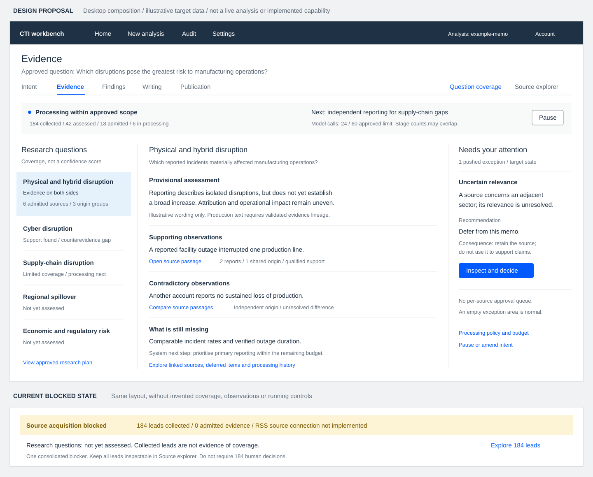

# Evidence Workspace and Source-Volume Plan

Status: Proposed implementation plan; not an activated admission or collection policy.

## Outcome

Turn the Evidence page from a list of collection leads into a question-led,
AI-operated research workspace. The system handles routine source processing;
humans approve intent and publication, supervise progress, and resolve pushed
exceptions. Source-level approval must not become the default operating model.

Success means answering: What can we use to answer each research question,
what challenges the emerging answer, and what remains missing?

## Current baseline and constraints

- Discovery retains every deduplicated provider item. Scores and source tiers
  prioritise leads; neither proves relevance, independence or reliability.
- Collection leads currently wait for an unimplemented RSS-connected source
  list. They are not admitted evidence. Removed publisher-retrieval commands
  must not be restored implicitly or replaced with an unapproved provider.
- Captured native Seerist content has a canonical-source adapter. Relevance and
  assurance mechanisms exist, but the complete automated path is not wired.
- `admitEvidenceUnderPolicy` already supports controller admission for eligible
  retrieved-source candidates. It is not a general admission mechanism for
  arbitrary native records. Missing admission settings retain human mode.
- `run:next` is a bounded next-action selector, not yet an autonomous evidence
  worker. Its current pending-model state names the future Foundry adapter.
- Per-source support review, assessment and adjudication remain interim
  stand-ins. They cannot be removed merely by hiding UI controls.

Use the existing TypeScript modules and artifact storage. Keep domain decisions
pure, orchestration in workflows, and side effects in thin commands. Preserve
historical runs and their policy versions. Do not introduce a new database,
generic agent framework, unobserved endpoint or mandatory cyber-specific logic.

## Target page

### Desktop layout proposal

[Open the full-size wireframe](../01-Architecture/evidence-workspace-wireframe.svg).
This is a planning illustration, not implemented UI. All target-state counts,
observations and assessment text are fictional. The lower panel shows how the
current 184-lead acquisition blocker should appear without inventing evidence.

The composition preserves the existing Night Sky shell, Blue Sky actions,
Vestas typography and rules-based layout:

- **Top:** one Evidence heading, the approved question, workflow navigation and
  a compact processing-status strip. Counts are labelled by stage, not
  presented as a certainty score.
- **Left:** approved research questions with explicit coverage or unassessed
  states. Selecting one changes the centre pane without losing context.
- **Centre:** the selected question's provisional assessment, supporting and
  contradicting observations, and gaps. Passage links expose lineage;
  shared-origin reporting is not counted as independent confirmation.
- **Right:** the pushed exception area. Inspecting an exception reveals the
  evidence and consequences before a decision. An empty queue stays quiet.
- **Secondary view:** Source explorer replaces the coverage body when selected;
  it does not append hundreds of source rows beneath the main workspace.
  Selecting a source opens its content and lineage alongside the list.

At narrower widths, question navigation becomes a selector, the centre remains
the main reading surface, and exceptions remain reachable through a labelled
attention control. Do not squeeze all three columns into a narrow viewport.
Keyboard and reading order follow status, questions, evidence and exceptions.

Running, paused, blocked, budget-exhausted and finished-with-gaps states change
the status strip and available actions. They do not replace missing assessments
with empty confidence meters. Phase 1 must use the blocked/unassessed version
where machine capabilities or validated artifacts are unavailable.

### Research status

One compact status area shows collection and processing activity, counts by
stage, budget consumption, and blockers. Distinguish running, paused, blocked,
budget-exhausted and finished-with-gaps states.

For the current blocked case, show the actual counts and one source-acquisition
explanation. Do not repeat the same RSS blocker for every lead or say
"Nothing is waiting" while processing is blocked.

### Research-question coverage

The approved information requirements are the primary navigation. Each question
shows admitted source coverage, supporting and contradicting observations,
unresolved gaps, and processing still outstanding.

Expand a question to inspect observations and their exact source passages.
Introduce provisional AI assessments only after their grounded artifact and
validation path exists. Counts, ranking scores and model self-confidence must
not become a synthetic certainty score.

### Exceptions

Show only actionable exceptions, with reason, affected questions, relevant
artifacts, recommended resolution and consequences. Push newly actionable items
through the app's notification surface; do not make humans poll source rows.
Routine processing and transient retries are not human tasks.

### Source explorer

Keep all leads accessible as a secondary searchable view. Support filtering by
question, event group, source origin and processing disposition. Explain why an
item was processed, deferred, excluded, grouped or blocked. Source drill-down
retains original metadata, content availability, provenance and stage history.

## Processing funnel

1. Validate scope metadata and collapse exact duplicate identities/content.
   Missing or ambiguous metadata is not proof of irrelevance.
2. Group likely same-event reporting and identify copied or shared-origin
   reports. Event similarity and source independence are separate relationships.
   AI grouping is a proposal, never a destructive merge.
3. Use bounded AI triage to propose question links, relevance, novelty and
   potential counterevidence. Label metadata-only triage provisional.
4. Resolve available sources through an approved adapter, canonicalise complete
   captured content, and perform anchored source-to-question relevance checks.
5. Prioritise deep processing by unmet question coverage, new information,
   independent origins, primary material and counterevidence. Do not select only
   by score or enforce an arbitrary global "top 20".
6. Admit eligible evidence through deterministic policy checks, then run the
   required source-assurance stages before it contributes to Findings.
7. Reassess coverage and marginal information gain. Collect further material
   only within approved intent, endpoint permissions and remaining budget.

Deferral is not rejection. Preserve the reason and allow deferred items to
return when gaps, new evidence or contradictions change their usefulness.
Conflicting reports must remain available, including conflicting versions
within one event group.

## Delivery sequence

| Phase | Deliverable | Completion boundary |
| --- | --- | --- |
| 1. Honest evidence overview | Replace the flat default list with research-question navigation, real pipeline counts, a consolidated acquisition blocker and the secondary source explorer. | Every lead is accounted for; unavailable assessments are explicitly unassessed. No fabricated coverage or automated-admission claims. |
| 2. Bounded source selection | Persist question links, reversible event groups, dependency proposals and explicit scheduling/defer reasons. Add deterministic exact deduplication and validated AI triage. | Repeated reporting cannot masquerade as independent corroboration; counterevidence and poorly covered questions receive processing opportunities. |
| 3. One working automated source path | Observe and test one approved source-acquisition mechanism, or use verified native captured content first. Wire canonicalisation, anchored relevance, eligible candidate conversion and controller admission under a governed policy. | One real source reaches an admitted snapshot without a per-source human click, with complete lineage and no authority shortcut. Unresolved leads remain blocked. |
| 4. Resumable evidence worker | Extend existing command/workflow readiness for the working path, integrate the configured model transport, bound concurrency/retries, and resume from immutable artifacts. | Pause/resume and process restart do not duplicate calls or approvals. Exhausted work emits a typed bounded failure. The UI shows the actual transport and readiness. |
| 5. Grounded coverage and automated assurance | Build question-level evidence projections from validated observations; implement the missing machine replacements required by the chosen path. Connect qualified outputs to Findings. | Each observation drills down to an exact passage. Partial assurance stays visible and publication-blocking as required; calibration limitations remain intact. |
| 6. Gap-driven continuation and stop decisions | Schedule further processing and approved-scope searches using coverage gaps, independence, contradiction and marginal gain. Record a terminal reason. | Distinguish sufficient coverage, saturation, acquisition blockage and budget exhaustion. Unanswered questions survive into Findings and memo limitations. |

Build Phase 1 first. Phase 2 can operate on metadata without claiming evidence
admission. Phase 3 is the end-to-end checkpoint before scaling the worker.
Phase 5 depends on validated question links and the working admission path;
Phase 6 depends on trustworthy coverage and budget enforcement.

The RSS/source-acquisition contract is a prerequisite for processing the current
unresolved leads, not a cosmetic page task. If the approved mechanism is not
available, demonstrate the pipeline with captured native content and retain the
blocker honestly. Do not mark the unresolved-lead path complete.

## Authority, budgets and stopping

Governance must set versioned policies for admission, source readiness,
grouping/selection behaviour and stopping thresholds. Intent approval records
the run's processing budget and permitted collection scope. Agree actual limits
before enabling unattended execution; this plan does not invent them.

The controller enforces provider-call, model-call, token/cost where observable,
elapsed-time and retry limits. Reserve budget before dispatch and reconcile it
afterward; concurrent work cannot overspend the remaining allowance. If actual
cost cannot be measured, show estimates as estimates and enforce measurable
call/token limits instead.

Models propose semantic outputs; deterministic code owns permissions,
validation, budget accounting, admission and transitions. Changing scope or
increasing an approved budget requires an explicit intent amendment. A pause or
stop preserves artifacts and does not declare the research complete.

Only the existing typed exception kinds are used: uncertain relevance,
unresolved reconciliation, key-judgement contest and bounded failure. A source
conflict is not automatically a human interruption; escalate unresolved
conflicts according to policy and their consequence for the answer. Preserve
the current stricter behaviour until an approved policy and tests replace it.

## Verification and acceptance

- A large lead set, including the current 184-lead case, produces a usable
  question-led overview rather than 184 required human decisions.
- Reposted articles retain provenance but do not inflate independent coverage.
  Similar events and contradictory accounts are not silently discarded.
- Metadata-only relevance cannot create an admitted snapshot or grounded claim.
- Counterevidence remains eligible when it challenges the current answer.
- Native and resolved-source paths respect their distinct adapter eligibility;
  invalid anchors, missing lineage, synthetic data and exhausted budgets block
  admission.
- Unsupported acquisition and missing machine stages display blockers rather
  than success-shaped fallbacks.
- Retries and restarts are bounded and resumable; failed and deferred items
  remain inspectable.
- Every displayed supporting or contradicting observation links to its source
  passage. Unassessed and unanswered questions remain visible.
- Historical human-mode runs keep their meaning. Enabling controller mode
  requires an explicit approved policy version.
- Publication still requires verification, explicit human approval and the
  prescribed sampled audit; automated support remains labelled unvalidated
  until the calibration contract permits otherwise.

Use deterministic module/workflow tests, command integration tests, and UI
state tests. Keep live provider checks separate. Run the existing dashboard
suite, `npm test`, `npm run typecheck` and `npm run build` for implementation.

## References

- [Implemented baseline](first-slice.md)
- [Target workflow and machine replacements](memo-workflow.md)
- [Human surfaces and controller admission](../02-Contracts/human-surfaces-and-calibration.md)
- [Evidence admission compatibility](../02-Contracts/evidence-admission.md)
- [Architecture boundaries](../01-Architecture/script-architecture.md)
